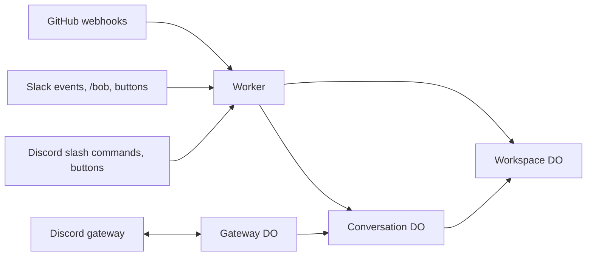

# Concepts

## One Worker, three kinds of Durable Object



| Object         | How many                        | What it keeps                                                                                        |
| :------------- | :------------------------------ | :--------------------------------------------------------------------------------------------------- |
| `Workspace`    | one, named after the GitHub org | the configuration, every news story and the cards drawn from it, the webhook deliveries already seen |
| `Gateway`      | one, named `discord`            | the Discord gateway session, so a restart resumes instead of reconnecting from scratch               |
| `Conversation` | one per conversation            | the full history the model saw, tool calls included, the queue of asks, and the drafts               |

The Worker itself keeps nothing. It checks signatures and hands each request
to the object that owns it.

### Why the Discord gateway needs its own object

Slack sends everything bob needs over HTTP. Discord sends slash commands and
button presses over HTTP too, but **messages and mentions only arrive over the
gateway**, a WebSocket that stays open. The `Gateway` object holds that socket.
An open outbound socket keeps a Durable Object in memory for at most fifteen
minutes; the heartbeat alarm, every forty seconds or so, keeps it there for good.
A cron every five minutes reconnects it after a deploy.

## The configuration lives in SQLite, and you can always see it

The Python version kept its configuration as messages in a `#bot-config`
channel. That does not work on Slack's Free plan, which hides messages older
than 90 days, so the configuration moved into the `Workspace` object's SQLite
database. `/config` (Discord) and `/bob config` (Slack) show all of it, only to
whoever asked.

What is stored is only what bob cannot ask GitHub:

- **Repo channels.** A repo's _home_ channel on each platform gets its news,
  and settles which repo an issue drafted there belongs to. An _announce_
  channel, when set, takes the news instead, so several repos can share a feed.
- **People.** One row per person, with their GitHub login, Linear email,
  Discord id and Slack id. Linking a login from Discord and the same login from
  Slack joins them into one person, so a mention reaches them on both.

## A story per thing, a card per story

Each issue, pull request and commit pipeline is one **story**, stored whole in
SQLite. A webhook event changes a story, and the card is drawn again from it.
That is why events that arrive out of order, or twice, still land on one card,
and why a card for a pipeline shows every workflow and job of a commit as one
line each.

The card is posted once per platform that follows the repo, and edited after.
When a card is old enough that an edit would go unnoticed, the next change
posts a fresh one. Mentions go in a reply under the card, so the card itself
stays clean and a ping always notifies.

## Three layers: what happened, how it reads, where it shows

```text
src/news, src/agent, src/commands.ts   what happened: stories, runs, drafts, command results
src/ui                                 how it reads: cards, replies and button labels
src/discord, src/slack                 where it shows: events in, embeds or Block Kit out
```

The domain modules never write a sentence a person reads. A story records that
an issue closed as not planned; a command reports that it mapped a repo; a run
reports how it ended. `src/ui` turns those into cards and replies, all in one
place and in one voice: the colours, the emoji, the verbs. Its functions are
pure, so the same story always draws the same card and a test can check a card
without a chat platform.

A card is written once, in Markdown, and each platform draws it: an embed on
Discord, Block Kit on Slack. Everything else that differs between the two sits
behind one interface, `Chat`, which posts, edits and reads messages. Buttons
carry an id like `bob:submit:12:slack:C1:1700.01`, which names the action, its
target and the conversation that owns it, so either platform routes the press
back to the right object.

To show something new, such as an agent's plan or a diff, add a view to
`src/ui` that takes the domain's state and returns a `Card`, reuse the emoji in
`src/ui/glyphs.ts` (adding a kind there if it is a new kind of thing), and test
it under `test/ui`. [Cards](cards.md) describes the visual language.

## What GitHub decides

- **Who can be assigned, and which labels exist.** The agent picks from what
  `repo_labels` and `teammates` return, and GitHub rejects anything else when
  the issue is filed.
- **What the agent can read.** Everything goes through the GitHub App's
  installation token. bob has no clone of any repo and nothing on disk.
